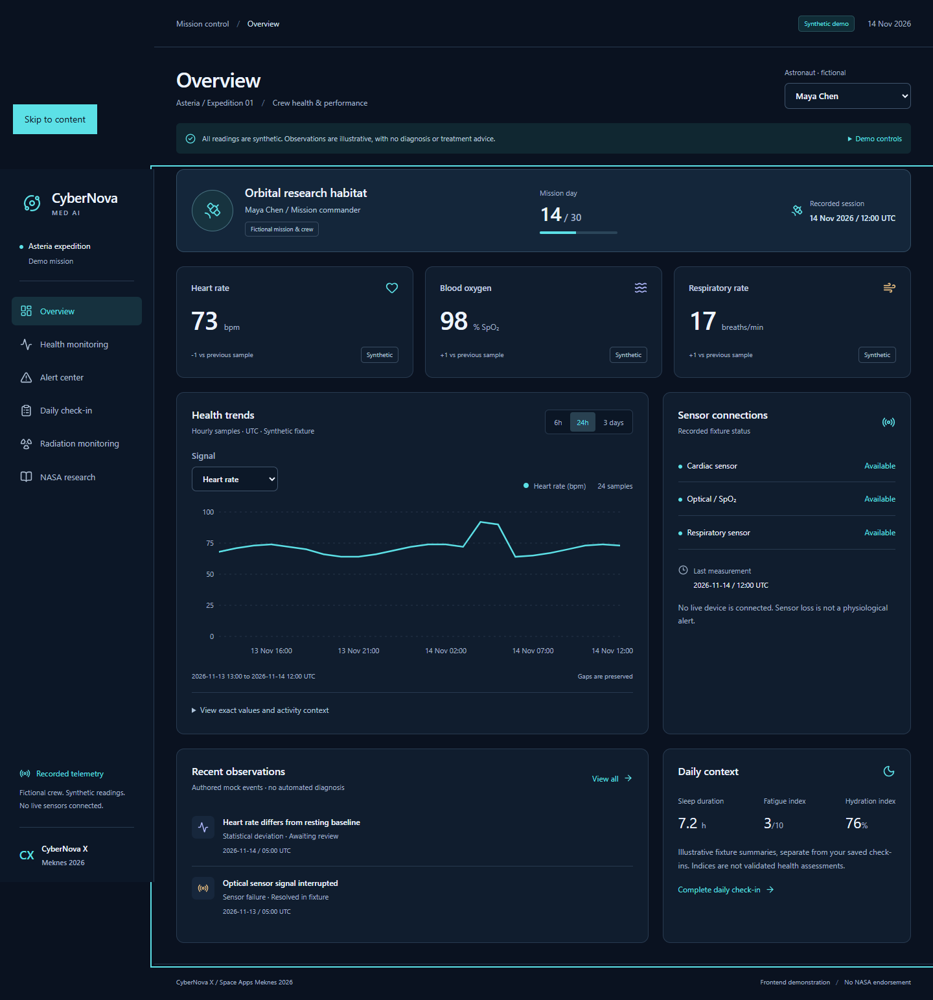

# CyberNova MED-AI

**An explainable, non-diagnostic crew-health monitoring demonstrator for space missions.**

CyberNova X brings synthetic astronaut telemetry, data-quality observations, daily self-reports, and radiation exposure tracking into one responsive mission-control workspace.



**Public demo:** [cybernova-med-ai.vercel.app](https://cybernova-med-ai.vercel.app) - synthetic Demo fixtures only; no public API or database is connected.

> Independent NASA Space Apps Challenge Meknes 2026 project. The crew, telemetry, check-ins, radiation, and backend demo records are synthetic. NASA is not a sponsor or endorser.

## The problem

Long-duration missions need a way to review changing crew observations alongside their source quality and mission context. Missing sensor data must remain visibly missing; an unusual measurement is not a diagnosis.

## What we built

- Six responsive screens: overview, health trends, observations, daily check-in, radiation tracking, and research context.
- Explicit Demo and Live API modes. Live failures stay visible; they never silently load demo fixtures.
- FastAPI + SQLite ingestion and persistence for synthetic simulator measurements, check-ins, and radiation readings.
- An explainable engineering demonstration of astronaut-specific, activity-specific rolling median/MAD and EWMA observations, with warm-up and sustained-sample requirements. Ali's review is required before calling the parameters scientifically validated.
- Sensor-data issues remain separate from statistical observations. Acknowledgment means reviewed operationally, not medically resolved.
- Radiation rate, completed 24-hour dose, and cumulative mission dose remain distinct quantities with explicit provenance. No unverified limits are applied.
- NASA OSDR OSD-53 **catalog metadata snapshot** on the research screen; no molecular expression values or NASA biometric dataset are analyzed.

## Architecture and data flow

```text
Amina's synthetic simulator ──> FastAPI validation/adapters ──> SQLite
                                          │                       │
                                      analytics                 typed API
                                    median/MAD/EWMA                 │
                                                                  ▼
Rayane's Next.js App Router <── explicit Live mode / Demo fixtures
Ayoub's research metadata ──> sourced context (not telemetry)
```

Khawla's backend work was taken over and is maintained by Rayane. Ali owns review and future evolution of statistical methods; the current integration-owned engine is disclosed in [analytics integration notes](docs/analytics-integration.md). Amina's simulator and Ali's original analytics prototypes are preserved.

## Tech stack

Next.js App Router, React, TypeScript, Tailwind CSS, Recharts, Lucide, FastAPI, Pydantic, SQLAlchemy, SQLite, Python, and pytest. See [architecture](docs/architecture.md) and the [v1 integration contract](docs/integration-contract-v1.md).

## Run locally

### Backend (PowerShell, repository root)

```powershell
python -m venv backend/.venv
backend/.venv/Scripts/python -m pip install -r backend/requirements.txt
backend/.venv/Scripts/python -m backend.app.cli init-db
backend/.venv/Scripts/python -m backend.app.cli seed-demo
backend/.venv/Scripts/python -m uvicorn backend.app.main:app --host 127.0.0.1 --port 8000
```

`seed-demo` prints the mission, astronaut, and source-session UUIDs. Save these for simulator runs. API documentation is at http://127.0.0.1:8000/docs. To run tests: `backend/.venv/Scripts/python -m pytest backend/tests -q`.

### Frontend (second PowerShell window)

```powershell
cd frontend
npm ci
Copy-Item ..\.env.example .env.local # optional; fill mission/session UUIDs from seed-demo
npm run dev
```

Open http://localhost:3000. Demo mode needs no backend. Live mode requires `NEXT_PUBLIC_API_BASE_URL` and `NEXT_PUBLIC_MISSION_ID`; live check-in submissions also need `NEXT_PUBLIC_SOURCE_SESSION_ID` from `seed-demo`. The local backend example binds to loopback and supports the local demo. The browser client does not send a write token, so do not expose a writable backend publicly; shared deployment needs an authenticated proxy/client flow first. Never put a write token in a `NEXT_PUBLIC_*` variable. The backend has a separate server-only environment example.

### Simulator and reproducible walkthrough

The API seed command gives a registered `amina_simulator_v1` source session. Run Amina's unchanged simulator against that session as documented in [backend setup](backend/README.md), then select Live mode in the dashboard. The exact 60–75 second walkthrough, fixed packet counts, and reset safety are in [the demo runbook](docs/DEMO_RUNBOOK.md). The original simulator file is maintained by its owner and is not copied or modified by this repository integration.

## Statistical method (engineering demo)

Eligible records are filtered by exact metric unit, quality, source and activity context. The current backend uses a median and robust MAD scale plus EWMA to identify only sustained deviations after warm-up. Its parameters are configurable demonstration values, not clinical cutoffs or a validated operational protocol. It does not diagnose, predict health outcomes, or recommend treatment. Full eligibility and review requirements are in [analytics integration](docs/analytics-integration.md).

## NASA research and data provenance

The application uses NASA references as context and displays a small snapshot of NASA OSDR OSD-53 **catalog metadata** (sample phases and study description). It does not ingest or analyze OSD-53 processed molecular values, and OSD-53 is not the dashboard's biometric data. The actual measurements shown by the product are synthetic simulator records or deterministic demo fixtures. Dataset provenance and limitations are detailed in [NASA data provenance](docs/nasa-data-provenance.md).

## Responsible use and limitations

This is a hackathon research and engineering demonstrator, not a medical device. It cannot diagnose, establish fitness for duty, or advise treatment. Synthetic values cannot establish human-spaceflight outcomes. No physical sensors are connected, no official NASA threshold is implemented, and no NASA endorsement is implied. Have domain reviewers approve scientific terminology, units, alert settings, data governance, and intended use before any real operational or personal-data deployment.

## Team

- **Rayane** — team lead; frontend, integration, backend, deployment coordination.
- **Khawla** — original backend/API contribution; backend handoff to Rayane.
- **Ali** — statistical analytics ownership and review.
- **Amina** — sensor simulator and synthetic telemetry.
- **Ayoub** — indicator specifications, research references, scientific review.

## Acknowledgments

NASA Open Science Data Repository (OSDR) catalog and NASA Human Research Program resources are cited as research context; sources and access details appear in the app and docs. This independent project is not affiliated with or endorsed by NASA.

## Collaboration and submission

See [CONTRIBUTING.md](CONTRIBUTING.md) for the team workflow.

The complete project is on [`release/space-apps-2026`](https://github.com/rayaneDR/CyberNova-MED-AI/tree/release/space-apps-2026), pending review in [PR #1](https://github.com/rayaneDR/CyberNova-MED-AI/pull/1). The default `main` branch has not been changed. The public GitHub repository is [rayaneDR/CyberNova-MED-AI](https://github.com/rayaneDR/CyberNova-MED-AI). English entry text is in [docs/SUBMISSION.md](docs/SUBMISSION.md), the timed six-screen walkthrough is in [docs/DEMO_RUNBOOK.md](docs/DEMO_RUNBOOK.md), and the pitch script and Q&A are in `docs/PITCH_SCRIPT.md` and `docs/PITCH_QA.md`. The editable seven-slide deck and PDF are in [`submission/`](submission/).

## License

MIT. See [LICENSE](LICENSE).
